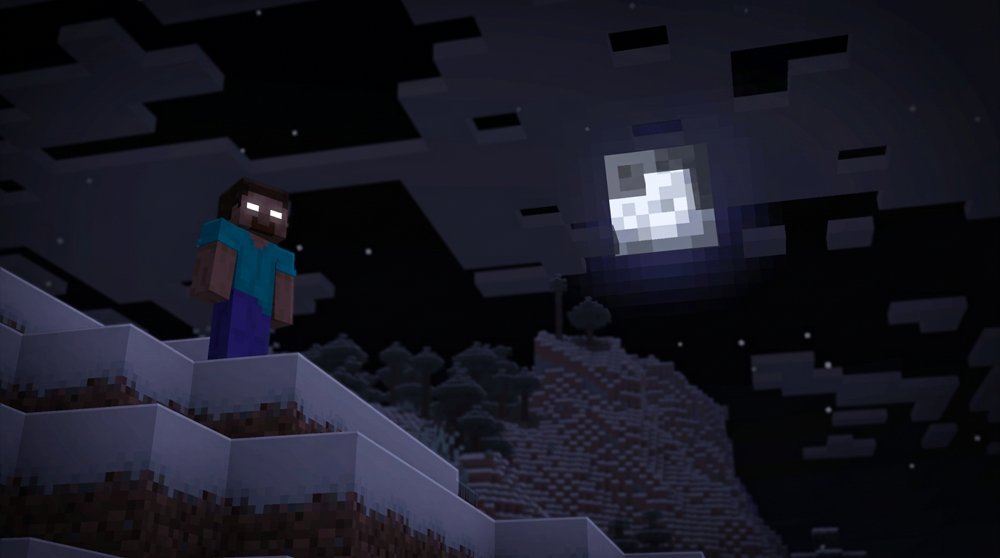

# Herobrine: Haunting

Herobrine for Fabric on Minecraft 26.3: staged hauntings, seven apparitions, the fog closing in, 13 original sounds,
gold shrines, churches, holy water and the cross. Non-destructive by design.

**[Source & safety guide](website/)** — From The Fog provenance, integration, licensing, and the optional `WAKE_UP.vbs` safety note.

## Summary

Herobrine: Haunting brings staged, escalating hauntings to Fabric on Minecraft 26.3 — seven apparitions, 13 original
sounds, gold shrines, churches, holy water and the cross. Non-destructive by design.

## Purpose

Herobrine: Haunting is a Fabric mod for Minecraft 26.3 that adds a staged, escalating haunting system centered around
Herobrine. It is non-destructive by design: the haunting alters the world procedurally (torches placed, leaves stripped,
tunnels dug, pyramids built) but never touches player-built structures, with the single optional exception of fire,
which is behind its own switch.

## Features

- **Staged hauntings** — the haunting escalates every two in-game days across four stages. Events roll more frequently,
  apparitions appear closer, and from stage 3 he sometimes hunts instead of watches.
- **Seven apparitions** — Watch, Runner, Lurking, Dwelling, Scare, Jumpscare, Spike — ranging from a distant watcher to
  a figure in your face, with a 1-in-12 chance of starting a chase frenzy.
- **Chase mode** — a few minutes where apparitions come three times as often and he refuses to leave you alone.
- **13 original sounds** with in-game subtitles (whispers, footsteps, heartbeat, mining, glitches, fog, the haunting
  track, and more). Every one is synthesised for this mod; no audio is taken from any other mod or resource pack.
- **A ten minute haunting track** — drone, wind, distant bells and something moving under the floor, that builds,
  peaks and thins out again. It plays when he is genuinely close, with more than ten minutes between plays so it
  never overlaps itself, and it fades to silence at both ends so it loops cleanly. Named `herobrine:music_haunt`,
  so you can play it any time with `/playsound herobrine:music_haunt music @s` — handy if you want it under a
  recording.
- **World events** — torches placed, lights snuffed or swapped, signs with one line, doors opening themselves, sand
  pyramids (including out in water), gravel mounds, gold-and-redstone markers, mined trees, groves stripped bare,
  haunted animals, ghost miner pickaxe sounds, long 2x2 tunnels running into the hillside, and window sightings
  lit by a soul torch so you can actually make him out at night.
- **Churches** spawn in the world with a holy-water cauldron on the altar; bottle holy water with an empty bottle.
- **Gold shrine** — eight gold blocks and four redstone torches, sunk one block into the ground so only the
  netherrack and the torches break the surface, lit with flint and steel.
- **Items** — Iron Stick, Holy Water, The Cross — the cross banishes him when it holds.
- **Iron-stick gear** — hammer Iron Sticks into a sword, helmet, chestplate, leggings and boots. Iron is the one
  thing he will not come near: carrying it turns away up to six apparitions in ten, and striking an apparition
  with it makes him retreat instead of turning on you.
- **Cold Iron advancement** — awarded for hammering your first piece of iron-stick gear.
- **Notch Apple ritual** — burn a Notch Apple on netherrack to banish him to the void (or call him back).
- **Steve friend** — summon Steve to travel with you; set him to stay or follow.
- **Animated glowing eyes** — both of Herobrine's eyes carry a softly pulsing halo on every entity
  form: white for the stalker and red for the hostile and elite forms. The halo is masked to the
  front face of the head, so it stays off the hair, the nose and the body. The halo itself is a
  client-side rendering effect, not an animated player skin.
- **His eyes cast real light** (optional) — install
  [LambDynamicLights](https://modrinth.com/mod/lambdynamiclights) and he lights the ground around
  him: the snow at his feet, the walls of a tunnel, whatever he is standing in. The halo alone
  illuminates nothing, which a shader pack will show you the moment you shoot him in the dark.
  See [Eye lighting](#eye-lighting) below.
- **Purist mode** (True Herobrine rules) — he never edits a block, never sends chat, never attacks — he only ever
  appears above Y 60 in the Overworld and watches.
- **Banish toggle** — send him to the void until you call him back.
- **A switch for everything** — every feature below can be turned off on its own, per dimension. World events,
  each of the seven apparitions, sounds, music, the fog closing in, churches, Steve, the Notch Apple ritual, the
  shrine and the bundled From The Fog content. **All on** / **All off** does the lot in one press. Everything
  defaults to the behaviour it has always had, so an existing world keeps running exactly as you left it.
- **Name him what you like** — one name, up to 16 characters of letters, numbers and underscores, used for the
  fake join and leave messages, his line of chat, his nametag and death messages, the jumpscare subtitle and the
  signs he leaves. Server-wide, read by everyone, changed only by an operator. **Reset name** puts him back to
  Herobrine.
- **Settings screen** (H key) saved per world: five tabs — World, Apparitions, Sound,
  Presence, Name — plus purist, banished and the music-volume slider.
- **Commands** — `/herobrine summon`, `haunt`, `apparition`, `mode`, `schizo`, `shrine`, `give`, `config`, `phantom`,
  and more.
- **No sleep** while he stands nearby.
- **From The Fog content** (optional, off by default) — the bundled
  [From The Fog](https://github.com/LunarEclipseStudios/From-The-Fog) datapack by Lunar Eclipse
  Studios ships with the mod. Its tick and load functions are deliberately *not* registered with
  Minecraft's `tick`/`load` function tags, so they never run on their own; turn on **From The Fog**
  in the settings screen or with `/herobrine config fog` to run them. See
  [Bundled third-party content](#bundled-third-party-content) below.

The settings screen is also available through Mod Menu. Its Haunting and Audio & World tabs group
the existing controls, including a music-volume slider. Changes apply immediately; Reset defaults
restores the current dimension's settings. Join a world before changing settings: commands require
cheats in singleplayer or operator permission on a server. In multiplayer, install the same mod
version on the server and check chat for confirmation; the screen cannot read server settings.
The world continues running while the settings screen is open.

## Compatibility

- Herobrine: Haunting 3.0.5
- Minecraft 26.3
- Fabric Loader >= 0.19.0
- Fabric API >= 0.165.0
- Java >= 25
- Suggests Mod Menu >= 21.0.0 for in-game settings integration
- Runs on both client and server; settings are saved with the world and apply per dimension
- Suggests LambDynamicLights for eye lighting; the mod ships the definition, nothing is required
- Works with shader packs (Iris and others). The fog and the glowing eyes are drawn so that a shader pack
  cannot drop them: the eyes travel the same path vanilla uses for an enderman's, and the fog falls back to
  a HUD-layer overlay when a pack replaces the fog pipeline. With no shader pack loaded nothing changes.

## Eye lighting

The glowing halo on his eyes is drawn on the surface of the model: it is bright, but it does not
light anything. Stand him in snow at midnight with a shader pack on and he reads as a bright
texture on an unlit figure.

For real illumination the mod ships an entity lighting definition for
[LambDynamicLights](https://modrinth.com/mod/lambdynamiclights), the dynamic lighting mod that
shader packs understand. With it installed he carries a light of **10** — enough to pool on the
ground at his feet and catch on falling snow, not so much that he looks like a walking torch.
Nothing is required of you beyond putting the mod in your mods folder: the definition is already in
the jar at `assets/herobrine/dynamiclights/entity/herobrine.json`.

To change how bright he is, override that file in a resource pack. Values are Minecraft light
levels, 0 to 15 — for reference, the mod gives an allay 8, a blaze 10 and a glow item frame 12.
To make the light only appear in the dark, add a `located` block to the `match` section:

```json
{
  "match": {
    "type": "herobrine:herobrine",
    "located": { "light": { "sky": { "max": 7 } } }
  },
  "luminance": 12
}
```

Without LambDynamicLights installed nothing changes and nothing breaks — the file is simply never
read.

The track is synthesised rather than recorded, and the generator that builds it is in the repository
at `tools/generate_haunting_track.py` — pip install numpy and soundfile, then run it from the repo
root to regenerate the file. Tweak the bell times, the melody or the drone partials and re-run.

## Bundled third-party content

This mod bundles an unmodified copy of the [From The Fog](https://github.com/LunarEclipseStudios/From-The-Fog)
datapack under `src/main/resources/`, in its own namespaces
(`lunareclipse.watching`, `lunareclipse.utils`, `from_the_fog`, `watching`). Nothing from its
`assets/minecraft` or `data/minecraft` folders is included, so **no vanilla textures, sounds,
shaders or function tags are overridden**, and its tick/load functions are not registered with
Minecraft's `tick`/`load` tags — they run only when you switch **From The Fog** on.

The bundled content is licensed **CC BY-NC-SA 4.0**, which is a **non-commercial** license: the
same terms this mod uses. See [LICENSE_FROM_THE_FOG.md](src/main/resources/LICENSE_FROM_THE_FOG.md)
for the full text.

## Credits

- **From The Fog** by Lunar Eclipse Studios
  ([https://github.com/LunarEclipseStudios/From-The-Fog](https://github.com/LunarEclipseStudios/From-The-Fog)),
  CC BY-NC-SA 4.0. Bundled verbatim, unmodified, in its own namespaces.

## License

Herobrine: Haunting is **CC BY-NC-SA 4.0** — see [LICENSE](LICENSE). Bundling From The Fog does not
change that: both are non-commercial Share-Alike, so the combined work stays
**CC BY-NC-SA 4.0** and may not be used commercially.

## Source

https://github.com/BT-Studio-dev/Herobrine

## Commands

```
/herobrine summon [stalker|hostile|elite|watcher]   (no form = stalker)
/herobrine haunt [player]
/herobrine apparition <watch|scare|jumpscare|spike|runner|lurking|dwelling> [player]
/herobrine leaves | tunnel | structure [water] | tree | cobble | warts
/herobrine gravel | marker | herd | miner | window
/herobrine torches | curse | candles | sign | donation | door | fire
/herobrine phantom [add|clear]
/herobrine mode [full|purist|toggle]
/herobrine schizo [on|off] | hauntstate | settings | banish [on|off]
/herobrine shrine [gold] | church | give <iron_stick|iron_sword|iron_helmet|iron_chestplate|iron_leggings|iron_boots|holy_water|the_cross>

/herobrine config <setting>              toggle one feature on or off
/herobrine config all <on|off>           switch every feature on or off at once
/herobrine config reset                  restore every feature to its default
/herobrine config name <text>            the name he goes by (16 characters, letters/numbers/underscores)
/herobrine config name reset             back to "Herobrine"

settings: torches leaves tunnels structures trees cobble warts gravel markers
          herd miner window doors signs candles curse donation fire
          watch runner lurking dwelling scare jumpscare spike
          sounds music fog_closing_in churches steve notch_apple shrine from_the_fog
aliases:  schizo = sounds   arson = fire   fog = from_the_fog
```

The fog closes in when he is close. His own sounds are in the subtitles.
